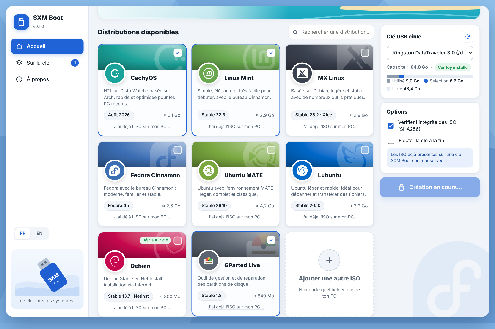
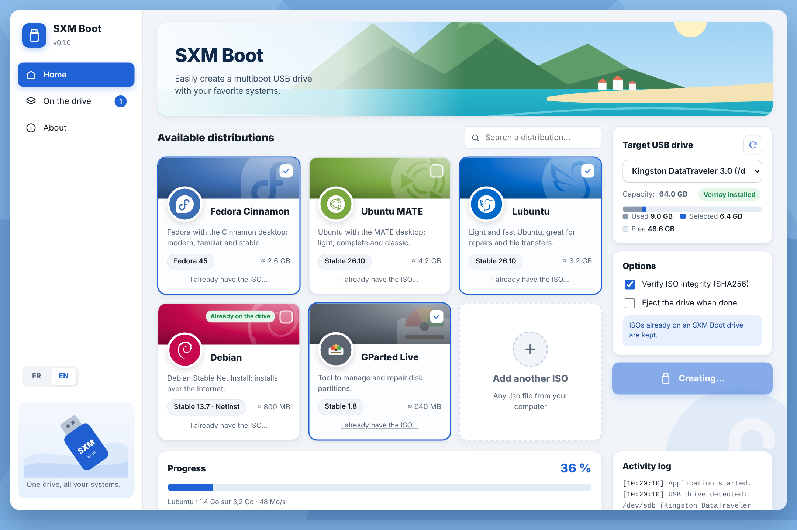

<div align="center">

# SXM Boot

**Une clé, tous tes systèmes. · One drive, all your systems.**

Créateur de clé USB multiboot, simple et joli, pour Fedora et macOS.
A simple, good-looking multiboot USB creator for Fedora and macOS.

[Français](#français) · [English](#english)



</div>

---

## Français

### Pourquoi SXM Boot ?

Ventoy est excellent, mais il faut trouver, télécharger et vérifier chaque ISO soi-même. SXM Boot fait tout ça pour toi dans une interface claire :

- **Coche, clique, c'est prêt** : les systèmes sont téléchargés directement sur la clé.
- **Vérification SHA256 automatique** de chaque ISO, à partir des sommes officielles.
- **Tes ISO à toi** : ajoute n'importe quel fichier `.iso` de ton ordinateur.
- **Rien n'est perdu** : les ISO déjà sur la clé sont conservées, tu ajoutes ou retires à volonté.
- **Sécurité** : seules les clés USB sont proposées, jamais tes disques internes.
- **Français et anglais**, au choix dans l'appli.

### Systèmes proposés

Le top 5 de DistroWatch (6 derniers mois), plus une sélection pour le dépannage :

| Système | Version | SHA256 |
|---|---|---|
| CachyOS | Août 2026 | ✓ |
| Linux Mint Cinnamon | 22.3 | ✓ |
| MX Linux Xfce | 25.2 | ✓ |
| Fedora Cinnamon | 45 | ✓ |
| Ubuntu MATE | 26.10 | ✓ |
| Lubuntu | 26.10 | ✓ |
| Debian (Net Install) | 13.7 | ✓ |
| GParted Live | 1.8 | — |

### Installation

Télécharge la dernière version dans **[Releases](../../releases)**.

**Fedora**
```bash
sudo dnf install ./sxm-boot-*.x86_64.rpm
```

**macOS** : ouvre le `.dmg` et glisse SXM Boot dans Applications. L'appli n'étant pas signée par Apple, fais **clic droit → Ouvrir** au premier lancement (ou `xattr -cr "/Applications/SXM Boot.app"`).

> Sur macOS, la préparation d'une clé vierge (Ventoy) se fait une seule fois sous Linux. Ensuite, tout se gère depuis le Mac.

### Démarrer sur la clé

Désactive Secure Boot dans le BIOS, puis appuie sur **F12**, **F11** ou **Échap** au démarrage (selon la marque) et choisis la clé.

---

## English



### Why SXM Boot?

Ventoy is great, but you still have to find, download and verify every ISO yourself. SXM Boot does all of that for you in a clean interface:

- **Tick, click, done**: systems are downloaded straight onto the drive.
- **Automatic SHA256 verification** of every ISO against the official checksums.
- **Bring your own ISOs**: add any `.iso` file from your computer.
- **Nothing gets lost**: ISOs already on the drive are kept; add or remove at will.
- **Safe**: only USB drives are listed, never your internal disks.
- **English and French**, switchable in the app.

### Installation

Grab the latest version from **[Releases](../../releases)**.

**Fedora**
```bash
sudo dnf install ./sxm-boot-*.x86_64.rpm
```

**macOS**: open the `.dmg` and drag SXM Boot to Applications. The app is not signed by Apple, so **right-click → Open** on first launch (or run `xattr -cr "/Applications/SXM Boot.app"`).

> On macOS, preparing a blank drive (Ventoy) must be done once on Linux. After that, everything can be managed from the Mac.

### Booting from the drive

Disable Secure Boot in the BIOS, then press **F12**, **F11** or **Esc** at startup (depending on the brand) and pick the USB drive.

---

## Compiler / Build

```bash
# Fedora
sudo dnf install webkit2gtk4.1-devel openssl-devel librsvg2-devel gcc rpm-build nodejs
curl --proto '=https' --tlsv1.2 -sSf https://sh.rustup.rs | sh
npm install
cd src-tauri && npx tauri build --bundles rpm
```

Les versions `.rpm` et `.dmg` sont aussi compilées automatiquement par GitHub Actions.
Both `.rpm` and `.dmg` are also built automatically by GitHub Actions.

## Licence / License

© 2026 Laurent Honoré — [GNU GPL v3 ou ultérieure / or later](LICENSE).

Moteur de démarrage / Boot engine: [Ventoy](https://www.ventoy.net) (GPLv3). Logos: [Simple Icons](https://simpleicons.org) (CC0). Les noms et logos des distributions sont des marques de leurs propriétaires respectifs ; SXM Boot n'est affilié à aucune d'elles. / Distribution names and logos are trademarks of their respective owners; SXM Boot is not affiliated with any of them.
